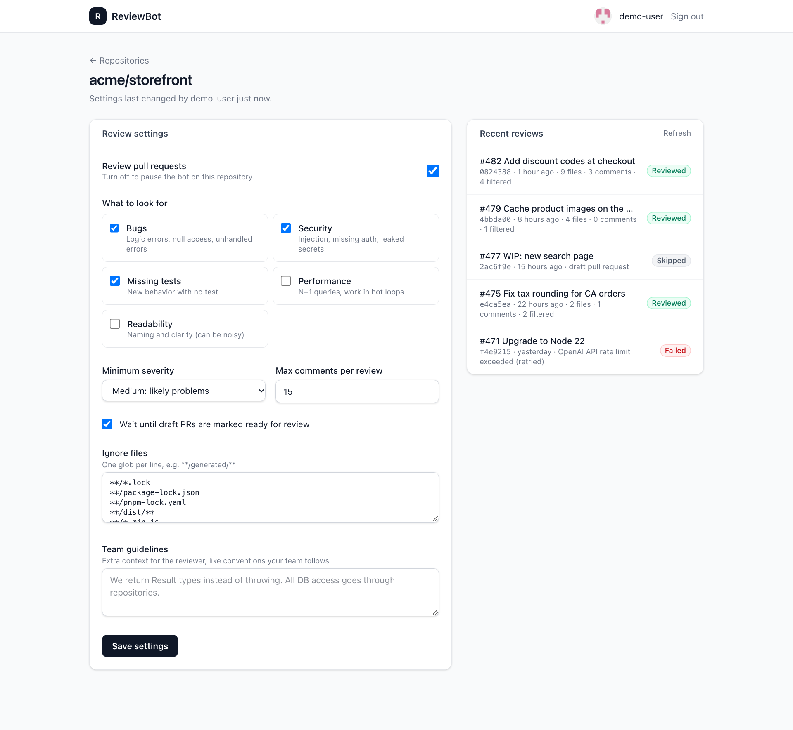
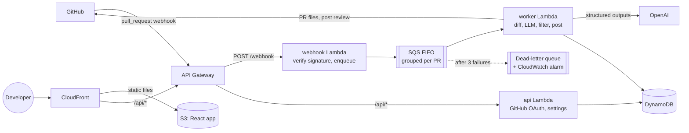

# ReviewBot

[](https://github.com/Zaki-Tahir/reviewbot/actions/workflows/ci.yml)

A GitHub App that reviews every pull request with an LLM. It leaves inline comments on likely bugs,
security issues and missing tests, suggests fixes GitHub can apply in one click, and writes a
plain-English summary of the change. A React dashboard lets each team tune what it looks for.

It runs on an event-driven, serverless AWS stack: API Gateway, Lambda, SQS (with a dead-letter
queue), DynamoDB and CloudFront, all in Terraform with separate staging and production environments.



## What a review looks like

The bot posts **one** GitHub review per push: a summary at the top, plus inline comments.

> ### ReviewBot
>
> Adds discount codes at checkout: a new `discount_codes` table, validation in the cart service,
> and the code input on the payment page.
>
> Reviewed 9 files: 1 bug, 1 security, 1 missing test.
>
> <sub>4 lower-confidence notes were left out.</sub>

An inline comment on `src/checkout/discount.ts` line 42:

> **🐛 Bug** (high): Percentage discounts over 100% make the total negative
>
> `applyDiscount` subtracts `total * pct / 100` without clamping, so a code with `pct: 150` produces
> a negative charge. Clamp the result at zero.
>
> ```suggestion
>   return Math.max(0, total - (total * pct) / 100);
> ```

## Architecture



### Life of a review

1. A developer pushes to a PR. GitHub sends a `pull_request` webhook.
2. The **webhook Lambda** checks the `X-Hub-Signature-256` HMAC, keeps only `opened`,
   `synchronize`, `reopened` and `ready_for_review`, puts a job on SQS and returns `202` in a few
   milliseconds. (GitHub gives up on webhooks after 10 seconds; model calls can take much longer.)
3. The **worker Lambda** picks up the job:
   - loads the repo's settings and claims the commit SHA in DynamoDB, so a duplicate delivery can't post twice
   - skips drafts, closed PRs and commits that a newer push has already superseded
   - fetches the changed files, drops ignored and binary ones, and parses each patch into new-file line numbers
   - splits large PRs into chunks and reviews up to three at a time with OpenAI **structured outputs**,
     a strict JSON schema validated again with Zod
   - filters the model's comments and posts a single GitHub review
4. If anything throws, the run is marked `FAILED` and SQS retries it. After three failures the job
   goes to the dead-letter queue and a CloudWatch alarm fires.

### Design decisions

- **What the bot leaves out matters most.** [filter.ts](apps/functions/src/core/filter.ts) drops
  comments in disabled categories, below the repo's minimum severity, under 0.6 confidence, on
  lines that aren't in the diff (GitHub rejects the whole review otherwise), and duplicates. Then
  it keeps the most important ones up to the repo's limit. Every review says how many were left out.
- **Line numbers the model can't get wrong.** The diff is shown to the model with new-file line numbers
  in a gutter ([diff.ts](apps/functions/src/core/diff.ts)), and the parser records exactly which
  lines can take an inline comment.
- **Idempotent by commit.** The claim is a DynamoDB conditional write on `repo#pr#sha`. A failed
  run, or one stuck for more than 15 minutes, can be claimed again; a finished one can't. An
  integration test races five workers on the same commit and expects exactly one to win.
- **FIFO queue grouped per PR.** Pushes to the same PR are processed in order, while different PRs
  run in parallel. GitHub's redelivery of a webhook is de-duplicated by its delivery ID.
- **Bounded cost.** Reserved concurrency on the worker caps parallel reviews, so a burst of pushes
  can't exhaust the OpenAI rate limit or the budget.
- **Sessions without a session table.** The dashboard session is an encrypted cookie (JWE,
  AES-256-GCM), because it carries the user's GitHub token. Every repo request re-checks access
  through GitHub, returns 404 for repos the user can't see, and changing settings needs write access.
- **Least privilege.** Each Lambda has its own IAM role with only the actions it uses, and the
  GitHub App asks only for `contents: read` and `pull_requests: write`.

## Tech stack

| Area | Tools |
| --- | --- |
| Backend | TypeScript, Node.js 22, AWS Lambda (arm64), Octokit, Zod, esbuild |
| AI | OpenAI Responses API with structured outputs (strict JSON schema) |
| Frontend | React 19, React Router, Vite, Tailwind CSS 4 |
| Data and messaging | DynamoDB (single-table, TTL), SQS FIFO with dead-letter queue |
| Infrastructure | Terraform: API Gateway HTTP API, Lambda, DynamoDB, SQS, S3, CloudFront, Secrets Manager, CloudWatch alarms, SNS |
| CI/CD | GitHub Actions: lint, typecheck, unit and integration tests, Terraform validation; OIDC deploys to staging on every merge and to production after approval |
| Testing | Vitest, Testing Library, DynamoDB Local |

## Try it locally

Requirements: Node.js 22+, Docker.

```bash
npm install
docker compose up -d                       # DynamoDB Local
cp apps/functions/.env.example apps/functions/.env
```

**Dashboard only, no GitHub App needed.** Set `LOCAL_DEMO=true` in `apps/functions/.env`, then:

```bash
npm run dev -w apps/functions              # API on :8787 (fake sign-in and demo data)
npm run dev -w apps/dashboard              # dashboard on :5173
```

**Review a real pull request from the terminal.** This prints the review instead of posting it, and
works on merged PRs too, which is handy for tuning the prompt and filters:

```bash
export OPENAI_API_KEY=sk-...
GITHUB_TOKEN=$(gh auth token) npm run review -w apps/functions -- https://github.com/owner/repo/pull/123
```

**The full flow with your own GitHub App.** Create an app using the settings in
[github-app.yml](github-app.yml), fill in the GitHub values in `.env`, run `npm run dev -w apps/functions`,
and point the app's webhook at `https://<your tunnel>/webhook` (for example with `ngrok http 8787`).

## Tests

```bash
npm test                    # unit tests: diff parsing, filtering, the review pipeline, handlers, API, dashboard
npm run test:integration    # DynamoDB store against DynamoDB Local (docker compose up -d first)
```

## Deploying

1. **Bootstrap once** with admin credentials. This creates the GitHub OIDC provider and a deploy role per environment:
   ```bash
   cd infra/terraform/bootstrap
   terraform init && terraform apply -var github_repository=Zaki-Tahir/reviewbot
   ```
2. In GitHub, create `staging` and `production` environments (add required reviewers to
   `production`). Set these variables on each: `AWS_DEPLOY_ROLE_ARN` (from the bootstrap output),
   `AWS_REGION`, `TF_STATE_BUCKET` and `APP_SLUG`, and optionally `ALARM_EMAIL`. Then set the
   repository variable `DEPLOY_ENABLED=true`.
3. Push to `main`. The [deploy workflow](.github/workflows/deploy.yml) builds the Lambdas and
   dashboard, runs `terraform apply`, uploads the dashboard and smoke-tests the API.
4. Put the app's secrets in the Secrets Manager secret from the `secret_name` output:
   `GITHUB_APP_ID`, `GITHUB_PRIVATE_KEY`, `GITHUB_WEBHOOK_SECRET`, `GITHUB_CLIENT_ID`,
   `GITHUB_CLIENT_SECRET`, `OPENAI_API_KEY` and `SESSION_SECRET` (`openssl rand -base64 32`).
5. Set the GitHub App's webhook URL and callback URL from the `webhook_url` and
   `oauth_callback_url` outputs.

Production deploys run from the Actions tab: **Deploy → Run workflow → production**.

## Project layout

```
apps/
  functions/
    src/
      core/        diff parsing, prompts and model calls, filtering, formatting, the review pipeline
      handlers/    Lambda entry points: webhook, worker, api
      github/      GitHub App client (installation) and user client (dashboard)
      store/       DynamoDB single-table store, in-memory store for tests
      auth/        encrypted session cookies
      local/       local dev server and the review CLI
    test/integration
  dashboard/       React app
infra/terraform
  modules/reviewbot     the whole stack as one module
  environments/         staging and production
  bootstrap/            OIDC deploy roles
```

## Ideas for later

- Answer replies to its own comments ("why is this a bug?") in the same thread
- Let teams mark a comment as unhelpful and use that to tune the filters per repo
- Per-installation usage tracking and monthly token budgets

## License

MIT
